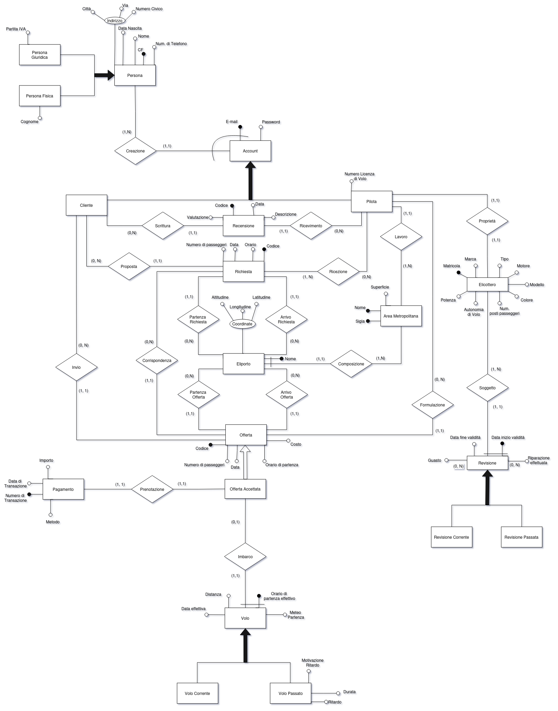
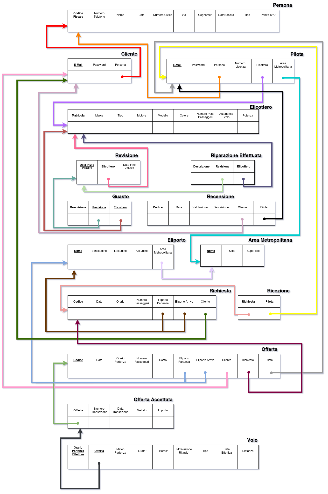

# 🚁 AirMetro Database

> Relational database design and implementation for **AirMetro**, a private helicopter transport service operating in Italian metropolitan areas. Developed as a university project for the **Databases** course (Academic Year 2023/2024, Track A40) at the University of Salerno (Unisa).

---

## 👥 Collaborators
- **Anzivino Giuseppe Fabrizio** — [@GiuseppeAnzivino](https://github.com/GiuseppeAnzivino)
- **Calabrese Raffaele** — [@RaffaeleCalabrese2](https://github.com/RaffaeleCalabrese2)

---

## 📋 Table of Contents
- [About the Project](#about)
- [The Domain](#domain)
- [Database Design](#design)
- [SQL Implementation](#sql)
- [Repository Structure](#structure)
- [License](#license)

---

<a id="about"></a>
## 🚀 About the Project
The project covers the full lifecycle of a relational database: requirements analysis, conceptual design (E-R), logical design, normalization and a PostgreSQL implementation with queries, views and triggers.

The complete report (in Italian) is available in [`docs/`](docs/). Table and column names in the SQL scripts are in Italian, as in the report.

---

<a id="domain"></a>
## 🌍 The Domain
AirMetro connects **pilots** (who own a helicopter) and **clients** who need a flight:

1. A client sends a **request** (date, time, departure and destination heliports).
2. Pilots operating in the area reply with **offers** including the total cost.
3. The client accepts one offer and pays by credit card or prepaid card.
4. The accepted offer becomes an actual **flight**, with data such as effective departure time, distance, duration, weather and possible delay.
5. Clients can leave **reviews** (5-star rating) about pilots.
6. Helicopter **maintenance** is tracked: periodic revisions, faults and repairs.

**Main business rules:**
- The service operates only in Italy, in **14 metropolitan areas**; each area must have at least one heliport and one pilot.
- Helicopters must be registered in Italy, built by *Bell Helicopter*, *Leonardo Helicopters* or *Airbus Helicopter*, and have at most **6 passenger seats**.
- Revision validity depends on the helicopter type (light, medium, heavy).
- Users can be natural or legal persons (tax code or VAT number).

---

<a id="design"></a>
## 🧩 Database Design
1. **Requirements analysis:** glossary, requirements split into sentences by concept, main operations.
2. **Conceptual design:** canonical E-R schema refined with design patterns:
   - recursive relationship reification
   - part-of
   - concept historicization
   - concept subset
   - attribute reification
   - binary relationship reification
   
   The phase ends with the final conceptual schema, the data dictionary and the business rules.
3. **Logical design:**
   - performance analysis (volume and operation tables)
   - redundancy analysis (payment amount and delay computation, both kept after evaluating the access costs)
   - generalization removal (Person, Account, Offer, Flight)
   - entity merging, removal of multivalued attributes, choice of primary identifiers
   - restructured schema and logical schema
4. **Normalization:** verification of 1NF, 2NF, 3NF and BCNF.

The diagrams were made with [draw.io](https://www.drawio.com/) and exported as PNG images, available in [`diagrams/`](diagrams/).

### Final Conceptual Schema


### Logical Schema


---

<a id="sql"></a>
## 🗄️ SQL Implementation
The scripts target **PostgreSQL** and include:

- **Schema creation:** custom domains (tax code, rating, metropolitan area, helicopter type, brand, weather) and tables with `CHECK` constraints and deferrable foreign keys.
- **Population:** sample data for all the tables.
- **Queries:** aggregation with join (average costs), complex nested query (flights departing from Naples), set operation (best rated pilots), plus additional queries (offers under 5000, prepaid card payments).
- **Views:** `GuadagniPiloti` (pilot earnings) and `PilotiRitardatari` (pilot delays), each with a query that uses it.
- **Triggers (PL/pgSQL):**
  - `AreaHaveOneEliport` and `AtLeastOnePilot`: minimum cardinality constraints
  - `VerifyMaxPosti` and `CheckOffertaBefore`: business rules on seats and offers

---

<a id="structure"></a>
## 📂 Repository Structure
```
.
├── README.md
├── LICENSE
├── .gitignore
├── docs/
│   └── Project.pdf                 full project report (in Italian)
├── diagrams/                       diagrams (PNG exports)
│   ├── ProgConcettuale.png
│   ├── Pattern.png
│   ├── RistrutturazioneLogica.png
│   ├── EliminazioneGen.png
│   └── Logico.png
└── sql/
    ├── Creazione_Popolamento.sql   tables and sample data
    ├── Query_Viste.sql             queries and views
    └── Triggers.sql                functions and triggers
```

---

<a id="license"></a>
## 📄 License
All rights reserved. This repository is published for viewing and educational reference only. See [`LICENSE`](LICENSE) for details.